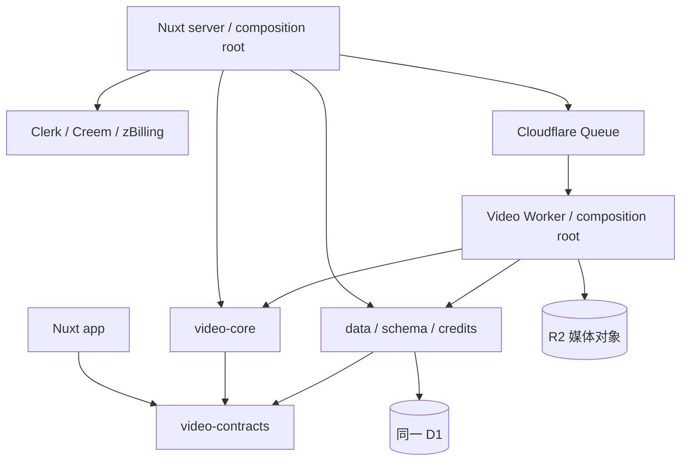
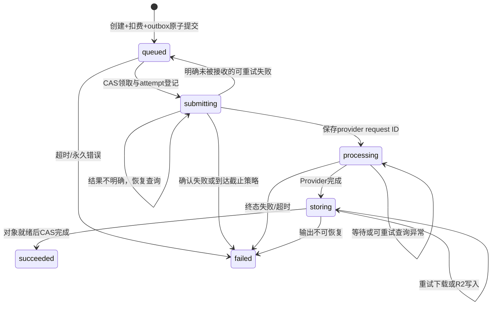

# Reelbam 总体架构与本地源码审计

审计日期：2026-10-31（Asia/Shanghai）。阶段：Phase 1，仅文档。本文中的“现状”来自本地源码静态检查；“建议”“拟建”均未实现，也未经过构建、数据库或 Worker 运行验证。

## 1. 现场状态、版本与边界

工作区：`/Users/apple/Desktop/Project/new-space`。

| 目录 | 现场状态 | 版本证据 | 本阶段用途 |
| --- | --- | --- | --- |
| `nuxt-sass-webszy/` | 本地模板文件，无 `.git`，无 `node_modules`、`.nuxt` | `package.json` 无项目 version；无法取得 commit SHA | 只读审计，作为未来主项目基线 |
| `shrimpreel/` | 有 Git 和 `node_modules` | HEAD `353351bbf4e8074d53e2cc219ddf79377402f8ac`；提交时间 `2026-10-28T15:54:57+08:00` | 只读审计，提取视频领域经验 |
| `reelbam/` | 开始审计时为空目录，尚未存在所描述的模板副本 | 无 Git、应用代码或依赖 | 本阶段仅创建 `docs/` 下三份文档 |

ShrimpReel 已有未跟踪项 `.idea/`、`pnpm-lock.yaml`、`pnpm-workspace.yaml`；HEAD 不能代表这些文件。未清理、覆盖或提交它们。Nuxt 无 Git 的版本缺口以本地内容指纹补充，不推断其远程仓库版本。

| 快照 | Nuxt 模板 | ShrimpReel |
| --- | --- | --- |
| `package.json` SHA-256 | `5261615178cda984d4dd06371df54b93280391dd52c04a7c042e6871855df2ed` | `70093b1910bd218f64729b1506f3e1f8088e1b817878afe8771eb764e4487ebb` |
| 本地文件集合 SHA-256 | `9c5250bb067b2e47293cf33359b8d9b44b8af004b9b4db82f9fc5c8a3a8fbd33` | `6ecebe1bfe5e84eb30c0071bef5349bdf13ff0044b78168217fdf830d3fb279f` |
| 集合文件数 | 77 | 279 |

指纹算法：递归读取常规文件，排除 `.git/`、`node_modules/`、`.idea/`、`.DS_Store` 和符号链接；按相对路径排序，将每个 `路径 + NUL + 文件SHA256 + LF` 串接后计算 SHA-256。该指纹包含本地锁文件，不代表线上部署版本。写文档前后按同一算法核对源目录。

三个目录均无 `.codegraph/`，本会话未发现 CodeGraph MCP；按无索引跳过规则及源目录只读限制，没有执行 `codegraph init`。没有重新克隆、安装依赖、读取真实密钥、访问远程 API、迁移数据库或部署。

## 2. 两个源项目的技术结构

### 2.1 Nuxt SaaS Starter 现状

| 层 | 实际实现 |
| --- | --- |
| 前端 | Nuxt `4.5.2`、Vue `3.5.40`、Nuxt UI `4.10.0`、Vue Router `5.2.0`、Tailwind 4；根目录 Nuxt，页面在 `app/` |
| 认证 | `@clerk/nuxt 2.6.21`；`ensureLocalUser` 验证 Clerk session token，读取 Clerk 用户资料并按 `clerk_user_id` upsert D1 本地用户 |
| API | Nitro 文件路由；错误 envelope、owner scope、`no-store` 已有基础实现 |
| 支付 | Creem；checkout、订单状态、账单摘要、历史、验签 webhook；当前只开放一次性积分包路径 |
| 数据 | `drizzle-orm 0.45.2` + D1；客户端从 `event.context.cloudflare.env.DB` 获取绑定 |
| 部署 | Nitro `cloudflare-module`；Wrangler `4.114.0`，入口 `.output/server/index.mjs`，静态资源 `.output/public`；除静态 ASSETS 外配置 D1，未配置 Queue/R2 |
| 工具 | pnpm 声明 `11.24.0`；TypeScript `6.0.3`；Node 原生测试 runner + TS transform 和自定义 alias loader |

依据：`package.json`、`nuxt.config.ts:1`、`wrangler.jsonc:1`、`server/services/users.ts:40`、`server/database/client.ts:5`。

**认证与身份。** Clerk 是唯一身份认证来源；D1 `users.id` 是本地业务主键，`clerk_user_id` 唯一。视频表必须引用本地 `users.id`，不能引用 ShrimpReel 的用户 ID，也不能把邮箱作为关联键。缺失认证函数、未登录或缺失 userId 会失败；Clerk 后端资料读取失败返回服务不可用，不创建伪造本地身份。每次调用 `ensureLocalUser` 都可能读取 Clerk 后端，不能宣称完整流程离线运行。

**支付路径。** `POST /api/billing/checkout` 先检查服务端支付开关，再认证，要求 `Idempotency-Key`，只接受白名单 price code。服务端从 D1 商品/价格/权益配置与共享合同核对数量、币种、金额，再验证 Creem 商品；按 `(user_id, checkout_idempotency_key)` 唯一约束决定创建 checkout 的胜者。返回页只查询本地 owner-scoped 订单，不以浏览器回跳参数作为到账凭据。未知创建结果保留 `CHECKOUT_CREATION_UNKNOWN`，不伪装成确定失败。

当前 `shared/billing-catalog.ts` 仅定义 5 / 10 / 30 积分包，对应 499 / 899 / 1999 USD 最小货币单位，有效期 365 天；这是源项目默认合同，不是 Reelbam 新定价决策。`database/catalog.sql` 默认商品和价格均 inactive，Wrangler 支付开关为 false，D1 ID 也是占位值，不能把“代码已有”写成“线上已可支付”。

**到账与账本。** Creem 原始 body 经 HMAC-SHA256 验签、归一化后才落库。支持的实际事件为 `checkout.completed`、`refund.created`、`dispute.created`；其他事件记录为处理完成但不发放权益。到账使用订单保存的 `entitlementSnapshot`，在 D1 batch 中更新订单并插入 grant 和 grant transaction；业务幂等标识从订单、权益、周期推导。Webhook 表同时按 `(provider, provider_event_id)` 去重；已处理的同一事件直接应答。

**退款。** 已成功的现金退款以支付商实付总额为固定分母，按累计退款比例计算累计应撤销积分，再减去以前的目标量；只从原订单对应 grant 回收其剩余量，不向其他订单借余额。`billing_refund_credit_adjustments` 保存目标、实际回收及 shortfall。`refund_version` 和余额条件断言用于冲突回滚。争议创建只登记 `billing_disputes`，没有最终裁决或自动撤销积分。没有发现主动发起 Creem 退款的 API；当前代码处理的是已验证的退款通知。

**现有表族。** `drizzle/0000_fast_magdalene.sql` 是唯一已提供的基线迁移，共 13 张表，与 `server/database/schema/index.ts` 对应：

| 表 | 责任 |
| --- | --- |
| `users` | Clerk 用户本地镜像；无 credits 缓存字段 |
| `billing_products`、`billing_prices`、`product_entitlements` | 商品、价格、权益合同 |
| `billing_customers`、`billing_subscriptions` | 客户/订阅的结构预留；不等于完整订阅执行能力 |
| `billing_orders`、`billing_webhook_events` | 订单、事件接收及重试审计 |
| `billing_refunds`、`billing_refund_credit_adjustments`、`billing_disputes` | 金额退款、积分回收、争议审计 |
| `entitlement_grants`、`entitlement_transactions` | 权益批次与唯一积分流水 |

`entitlement_grants` 的余额约束为 `0 <= remaining_quantity <= granted_quantity`，状态为 active / expired / revoked；`entitlement_transactions` 已允许 grant / consume / refund / expire / adjustment / revoke，并校验流水正负号及 `balance_after = balance_before + quantity`。这些 balance 是**单个 grant 的余额**。

`GET /api/me` 对有效、active、已生效且未过期（或不过期）的 credits consumable grant 求和；这是现有可用余额算法。`billing/summary` 主要提供最近到期和最近购买；余额应沿用 `/api/me` 语义。现有消费、返还、过期流水类型是结构支持，本次没有找到通用视频扣费/返还服务或定时过期落账流程。名为 `credit-ledger.ts` 的文件实际只有 checkout 权益合同比较函数，不能当成完整扣费引擎。订阅表和枚举存在，但当前 checkout 白名单排除了 recurring，不能直接宣称月度发放已实现。

### 2.2 ShrimpReel 现状

| 层 | 实际实现 |
| --- | --- |
| 前端/SSR | React `19.2.7`、TanStack Start `1.169.3`、TanStack Router `1.170.45`、Vite `8.3.4`、Tailwind 4 |
| HTTP/入口 | `src/server.ts` 组合 TanStack SSR、Hono `4.13.13` API、queue、scheduled；不是独立 Video Worker |
| 认证/支付 | 自有 sessions + Google 登录；Waffo / Dodo / Stripe / mock；不复用到 Reelbam |
| 存储 | D1 原生 SQL，无 Drizzle 数据层；R2 `MEDIA`；KV；15 份顺序 SQL 迁移 |
| 视频 | fal / yir / nanoapi / mock adapter；按全局 `VIDEO_PROVIDER` 选择，新任务保存 provider 字符串和 provider_meta |
| 队列 | 同一 Worker 既生产又消费 `VIDEO_QUEUE`；submit / poll 消息只含 generationId；主队列和 DLQ 均在同一入口处理 |
| 运维 | Cron 每 5 分钟，恢复任务、45 分钟任务超时、积分过期、订阅补发、查单、会话/媒体清理等混合维护 |
| 测试 | Vitest、Node SQLite 模拟 D1、Playwright Worker 流程测试；已读测试源码，未执行 |

依据：`src/server.ts:26`、`src/server/video/types.ts:3`、`src/server/jobs.ts:68`、`wrangler.jsonc`、`migrations/0001_init.sql`、`migrations/0009_credit_grants.sql`。

**视频适配层并非已解耦。** `VideoSubmitInput` 引用站点 `Style`，各 adapter 读取 `#/config/site` 和全局 `Env`，yir 还引用媒体 URL 工具。Provider id 是固定联合类型；模型路径、分辨率、prompt、估价和多步场景配置集中在站点配置内。现有多步协议 `pending.next` 可借鉴，但不能原样成为通用 Provider / Model / Capability 分离设计。

**任务状态机。** 只有 queued / processing / succeeded / failed。submit 先条件更新 queued → processing，防止普通重复消息同时提交；poll 支持多步 request ID 的条件推进；成功写入按 processing 条件竞争，失败和积分返还共用一个 batch。主队列批量大小 5、超时 2 秒、最大重试 10 次，错误延时 `min(300, 10 * 2^message.attempts)`；DLQ 批量大小 10、最大重试 3 次。pending 通过新延迟消息继续轮询；队列消息重试次数不是整个任务的总尝试预算。

**重复提交的真实边界。** HTTP 生成接口每次新建 generation ID；`generation:<id>` 只保护该任务的扣费，不能合并同一次客户端重试的两次 POST。前端 busy 状态不能替代服务端幂等。全站每日上限有 batch 内 guard，用户 active 数量上限只是写入前查询，存在并发穿透窗口。

submit 的 try 同时覆盖 Provider submit、保存 request ID 和下一条 poll 入队；任一步抛错都会尝试把 processing 改回 queued。这意味着 Provider 已接单、甚至 request ID 已保存但 poll 入队失败，也可能重新 submit。另有 Provider 已接单但本地未保存 ID 的中断窗口；Cron 对“processing 且无 request ID”的任务最多按 attempts < 3 重置后提交。CAS 只能减少本地并发，无法单独保证外部只计费一次。

- fal：源码提交没有业务幂等键，无法据此承诺外部提交幂等。
- yir：发送基于 generation/step 的 Idempotency-Key；固定图片签名时间、scene file_id 有助于请求体稳定。这是本地实现意图，未实测远端保证。
- nanoapi：以图片 URL + 源视频 URL 搜索最近任务，最多 5 页 × 100 项，3 小时窗口；查不到后仍会创建。它是有限查重，存在并发、列表延迟、分页遗漏，以及相同输入不能区分用户意图的问题。
- adapter 返回的 `failed.retryable` 在 `jobs.ts` 的 failed 分支没有使用，直接失败返还；可重试异常与可重试终态需要重新定义。

**积分。** `users.credits` 是批次余额缓存；正向入账创建 `credit_grants` 和 `credit_ledger`，扣费使用 SQL 窗口函数按先到期先扣，`credit_allocations` 保留扣费来源，并通过 `credit_guard` CHECK 保证足额，否则整个 batch 回滚。生成失败按原分配退回批次；旧任务无分配明细时另建永不过期批次，这个兼容兜底不适合新项目。普通订单现金退款优先回收原订单批次，但可继续回收其他批次；订阅退款才使用 onlyPreferred 限制。这与 Nuxt 的原订单限定规则不同。

**成本。** `generations.provider_cost_cents` 由成功路径写入：有 Provider 返回账单则使用，否则估算；yir 两步费用合并后也可能混有估算。没有币种、精度、actual / estimated 标识和逐次 attempt 记录。正常失败或中间步骤失败可能已经产生费用但不落账；源码“NULL 表示未出片未计费”的注释不能作为财务保证。成功出片与失败终态竞争时会额外保存一次已知费用，值得保留这一处理意图。后台汇总这些字段，不能原样称为精确利润。

**媒体与 UI。** 上传检查归属、文件大小及图片魔数，R2 存对象、D1 存元数据；媒体 API 支持 owner 校验、Range 和短期签名读取。成片先存 R2 再更新 D1；有失败后的补偿删除，但没有跨存储事务。`Generator.tsx` 是照片 + 模板参考视频 + 风格/时长的具体产品流程，3 秒轮询、失败后刷新余额；它耦合 React、session、支付和站点文案，只迁移交互需求，不复制组件或业务入口。

## 3. Reelbam 推荐结构与依赖方向

保留 Nuxt 在根目录，采用一个应用仓库、一个锁文件、两个独立部署单元。下图和目录是目标，当前尚未创建这些代码。

```text
reelbam/
├── app/                            # Nuxt/Vue/Nuxt UI；保留模板已有页面
├── server/
│   ├── api/                        # Clerk 认证、billing、视频 HTTP 边界
│   ├── services/video/              # 创建任务、报价/路由、owner-scoped 查询
│   ├── database/                   # 兼容导出与 H3 → DB binding 薄包装
│   ├── utils/zBilling/              # 保留支付编排、Creem 验签与现金退款语义
│   └── infrastructure/             # Nuxt 侧 queue、R2、媒体签名适配
├── packages/
│   ├── video-contracts/src/         # 公共 DTO、能力、任务状态、消息版本
│   ├── video-core/src/
│   │   ├── providers/              # 初期只实现 mock.ts 和 registry.ts
│   │   ├── ports.ts                # 抽象时钟、Provider、存储/任务等端口
│   │   ├── routing.ts              # 纯路由/能力校验
│   │   ├── state-machine.ts        # 纯转移规则
│   │   └── retry-policy.ts         # 重试分类；不操作 D1
│   └── data/src/
│       ├── schema/                 # 唯一 Drizzle schema，包含原有 billing 表
│       ├── repositories/           # D1/Drizzle 任务、attempt、outbox、媒体查询
│       └── credits/                # 同一账本的消费、返还、余额、结算原语
├── workers/video-worker/
│   ├── src/                        # queue / scheduled，平台适配及组合根
│   ├── wrangler.jsonc              # queue consumer + DLQ + D1/R2
│   └── tsconfig.json               # 独立于 Nuxt 生成 tsconfig
├── drizzle/                        # 唯一迁移历史；保留 Nuxt 基线
├── shared/billing-catalog.ts        # 唯一支付商品合同，不复制到视频包
├── docs/
├── drizzle.config.ts
├── pnpm-workspace.yaml
└── wrangler.jsonc                   # Nuxt Worker，D1 + queue producer + R2
```



依赖约束：

1. `video-contracts` 是叶子：普通 TypeScript，不导入 Nuxt、DB、core 或平台 binding；不放内部密钥或原始 provider_meta。公共 DTO 和内部消息/路由快照分入口导出，浏览器只使用公共 DTO。
2. `video-core` 只依赖 contracts、标准语言/Web API 和注入端口；不导入 Nuxt/H3、Clerk、Creem、Drizzle、D1、R2Bucket、Env 或项目站点配置。Mock 的等待用注入时钟和元数据表达，不用长时间 sleep；返回 fixture 引用，由 Worker 存储适配层读 R2。
3. `data` 只依赖 Drizzle/D1 和 contracts 中的值类型；不导入 server 或 worker，不调用支付/认证/Provider。它通过结构兼容的接口供 core 端口使用，组合根负责装配。无需建立 data → core → data 的循环。
4. server 与 worker 才能同时导入 core、data 和平台 binding。框架错误码在 HTTP 边界映射；core 错误不引用 H3 或 Nuxt 自动导入。
5. 禁止 `packages/data` 回头引用 `server/types/billing.ts`。未来先将 schema 所需枚举及 EntitlementSnapshot 移到 `data/schema/billing-values.ts`，原路径仅 re-export；其他 checkout 类型可留在 server。`server/database/schema/index.ts` 也仅做兼容 re-export，不保留第二份 schema。
6. `drizzle.config.ts` 最终指向 `packages/data/src/schema/index.ts`，迁移目录仍为根 `drizzle/`。消费包没有自己的迁移历史或数据库；根和 worker 都绑定同一环境的同一 D1。
7. `shared/` 不再存 video-contracts 的复制品；billing catalog 不搬进视频核心。`data` 是服务端包，前端不能通过混合 barrel 间接打包 DB/密钥模块。

迁移 schema 到 data 时先保证行为等价、约束/表名不变，再做新表增量；不是现在就重写模板账单代码。工作区注册 packages 和 worker 时保留已有 `allowBuilds`、`patchedDependencies` 和 Clerk patch，不能用 ShrimpReel 的工作区文件覆盖模板。

## 4. Provider、Model、Capability 和路由快照

| 概念 | 责任 | 不能承担的责任 |
| --- | --- | --- |
| Capability | 输入输出与参数约束，例如 `reference-to-video` 要求图片和参考视频；可用时长、尺寸、音频支持 | 不能等同某个商家的模型路径 |
| Model | Reelbam 的稳定模型标识、版本及能力集合，例如首版 `reelbam-mock-motion-v1` | 不保存商家密钥，不硬编码某个 provider |
| Provider | 调用协议、认证方式、submit/status 适配器及幂等/查询能力声明 | 不决定用户应扣多少积分 |
| Route | 将 model + capability 映射到 provider 的实际模型/endpoint、参数映射、约束和价格版本 | 不在任务重试时静默改变已选择路线 |

首版只启用 Mock 的 reference-to-video 路线，模拟现有照片 + 参考视频流程；text-to-video 等能力仅预留类型扩展点，不实现额外产品功能。可在纯测试中用两份 Mock provider 配置承载同一个 model，验证模型和 Provider 的多对多关系，不调用真实供应商。

任务创建时服务端验证输入并保存不可变快照：`schemaVersion`、`routeId/revision`、`modelId/version`、`capabilityId`、`providerId`、`providerModelId`、`adapterVersion`、实际非敏感参数、输入素材 ID/内容 hash、prompt/模板版本、积分报价及规则版本、成本估价及单位/币种。保存逻辑输入 hash，用于幂等冲突检查。实际签名 URL 不作为长期素材身份，不保存密钥；`credentialRef` 如需记录，只是服务端配置引用。

每次外部提交另保存 request payload hash、稳定 submit key、step、attempt 序号和 provider request ID；首次发出的临时 URL/请求元数据如需重用，保存在仅服务端可读的 attempt 中。签名到期后不能改 body 后仍假定旧幂等保证成立。旧任务按保存的路线和兼容 adapter 处理，不重新读取“当前默认 Provider/模型”。不同 Provider 只有在**新任务路由选择**时可替换；首版不做任务中自动跨 Provider fallback。

最小 Provider 端口建议区分 `submit(stepInput, routeSnapshot, submitKey)`、`poll(requestId, metadata)` 和可选的 `recover(submitKey)`；声明是否支持强幂等、恢复查询和取消。submit 结果区分 accepted / rejected / unknown，poll 只查询，返回 pending / completed / failed 及独立费用观察。多步任务由核心明确提出下一步 action，再经 Worker 登记 step/attempt 和提交；不照搬 yir 在 status 查询内部隐式创建下一付费任务的副作用。能力不支持的操作必须显式拒绝，不能由默认方法假装成功。

## 5. Worker、D1、Queues、R2 的边界

| 部署单元 | 权限与职责 | 不承担 |
| --- | --- | --- |
| 根 Nuxt Worker | Clerk、Creem、owner 鉴权；创建任务并扣费；D1 查询；上传/私有媒体读取；queue producer | 不执行耗时 Provider 轮询，不承载 queue consumer |
| 独立 Video Worker | 主队列和明确命名的 DLQ consumer；任务推进、attempt、Mock 调用、成片入 R2、失败结算；scheduled 恢复和 outbox 重发 | 不配置 Clerk/Creem 密钥，不新建付款或认证系统 |
| D1 | 用户、订单、权益、流水、任务、attempt、素材元数据、outbox、成本事实及操作记录 | 不存视频二进制 |
| Queue | 投递任务 ID/事件 ID/消息版本，是可重复、可重放的传输层 | 不作为任务状态、余额或唯一待办存储 |
| R2 | 私有原图、参考素材、Mock fixture、成片对象 | 对象存在不能自动认定任务成功，不保存余额/订单事实 |

两个配置的 DB binding 指向同一环境数据库，`migrations_dir` 可分别为根 `drizzle` 和相对 `../../drizzle`，迁移执行权只留在根流程。R2 同桶/明确前缀，队列生产者和消费者使用同一队列资源。生产和本地资源隔离；本地两个 Worker 要验证确实共享 D1/R2 持久化目录，不能各启动一份私有模拟 DB。无需引入 KV、Durable Objects、Service Binding 或第二个 HTTP 应用框架来完成首版。

首版 Mock 只允许明确的本地/测试环境；不沿用 ShrimpReel 公开 staging 的真实 Provider 配置。Video Worker 无需对公网开放业务 HTTP；未来 webhook 可由 Nuxt 验证并只触发 poll，以供应商查询结果为准，Phase 2 Mock 流程不依赖回调。

## 6. 拟建数据与可靠执行流程

以下是逻辑表草案，不是迁移文件；最终字段/索引需在下一阶段按实际约束生成并审阅。

| 新增对象 | 最小必要信息与约束 |
| --- | --- |
| `video_assets` | id、owner `users.id`、kind、R2 key、hash、content type、大小、可用/过期状态；owner 查询索引；素材删除须保护执行中任务引用 |
| `video_generations` | id、user_id、客户端幂等 key、input_hash、输入/路线/积分报价快照、status、version、deadline、terminal/error、输出 asset；`UNIQUE(user_id, idempotency_key)` |
| `video_attempts` | generation、step、attempt_no、submit_key、request ID、payload hash、执行子状态、lease owner/until、结果已知性；稳定 submit_key 唯一，provider request ID 按 Provider 范围去重 |
| `video_outbox` | event_id、generation、kind、not_before、payload_version、租约、投递次数/下一次时间；业务事件唯一；send 成功后才记已投递 |
| `video_credit_operations` | generation + consume/return 唯一操作标识、应扣/应返、实际恢复/因过期作废/因现金回收抵扣的结算结果；只登记操作，不形成第二份余额 |
| `video_provider_costs` | attempt/step、估价、实结价及状态、currency、整数金额单位、来源、观测时间、结算引用；唯一账单引用防止重复累计 |
| `billing_refund_credit_settlements`（条件需要） | 将晚到的视频返还中继续回收的数量关联原现金退款 adjustment，保留原 shortfall 历史；唯一 adjustment + return operation；实现前确认其核算字段 |

扣费来源直接由现有 `entitlement_transactions` 中 `source_type='video_generation'`、`source_id=generationId` 的 consume 行及 grant_id 表达，不再复制一套 credit_allocations 或信用账本。一个任务跨多个 grant 时有多行 consume；每个 grant 的 consume/refund 流水分别有确定幂等键。

Provider、Model、Route 初期使用服务端受版本控制配置，任务写快照；不必先做配置后台和三套可编辑数据库目录。成本行属于核算事实，不是用户积分余额。

### 6.1 创建与出队

1. Nuxt 通过现有 `ensureLocalUser` 获得本地用户，验证 owner、素材、参数、能力、额度和路由；客户端只能传模型/能力/素材与参数，不能指定实际扣费、余额、状态或 secret。
2. 客户端重试沿用同一幂等 key；同 key + 相同规范化业务输入返回同一任务，同 key + 不同输入返回 409。输入 hash 不包含易变签名 URL 和“当前默认路由”，重放时直接使用原任务快照；显式再次生成使用新 key。
3. 单次 D1 batch 同时写任务、consume operation、逐批次扣减与 consume 流水、首个 submit outbox。足额断言失败全部回滚；幂等操作冲突重新读取既有结果，不使用会悄悄跳过关键流水的 onConflictDoNothing。用户并发任务/每日限制也必须在同一写入边界约束。
4. commit 后尝试投递 outbox；send 失败保留待发，响应返回已创建 queued 任务，不因瞬时队列故障立即再创建任务或重复扣费。Video Worker scheduled 补发；send 成功而标记前中断允许重复消息。
5. 消费者按 event/generation ID 回读 D1，校验消息版本和当前执行状态，通过 CAS + 有期限 lease 领取 attempt；消息内状态不是权威。只 ack 已持久化处理结果或确定无须操作的消息。

### 6.2 状态与重试



failed 的确认与返还结算是同一个 D1 batch；succeeded 与 failed 互斥，旧 lease/旧版本不能覆盖终态。Provider submit 和 poll enqueue 必须拆开：拿到 request ID 后，poll 入队失败只补发 poll，不退回 queued。把“供应商明确未接收”“已接收”“可能已接收”建模为不同结果；网络超时不能自动推断未接收。

HTTP 429/网络/5xx 的退避、任务 deadline、单步 submit 次数、poll 次数、消息重试次数分别计量。pending 正常轮询不耗尽 submit 预算；使用定时延迟消息，不让 Worker 在一次调用中等几十分钟。DLQ 根据 D1 当前 attempt/版本与恢复能力判断，旧消息不能杀死已完成或已推进的任务；补偿失败继续重试，scheduled 最终兜底。任务实际超时后可失败并结算，但 Provider 是否已经计费仍需继续核对。

### 6.3 R2 一致性

输入上传、输出写入都不能和 D1 跨资源事务。采用可重试的对象 key、D1 状态、对象校验和清理补偿：未登记对象定期清理；对象写入后 D1 失败重试登记；D1 未标成功不返回可播放成片。并发输出优先使用 attempt/lease 相关临时 key，CAS 选定唯一输出资产；清理前查询引用，不能删掉获胜执行者的对象。保留 Range、私有读取、短签名、大小上限；未来真实输出下载另需校验允许的 URL/重定向、MIME、响应大小和超时，不能把任意 URL 交给通用 fetch。

## 7. 统一积分账本的接入方案

唯一余额仍是 Nuxt 的 `entitlement_grants`，唯一流水仍是 `entitlement_transactions`。支付发放、视频消费、视频失败返还、现金退款回收均修改这两个表；不新增 `users.credits`、`credit_ledger`、`credit_grants` 或第二个支付到账路径。

| 维度 | Nuxt 现状 | ShrimpReel 现状 | Reelbam 决策 |
| --- | --- | --- | --- |
| 用户余额 | 有效 grant 剩余量求和 | grant 剩余之和 + users 缓存 | 保留 Nuxt 的有效期过滤算法，无缓存事实源 |
| 扣费分配 | 类型/约束已有，通用执行器缺失 | SQL 窗口分配 + guard + allocations | 适配分配算法，写原 grant 和原 transactions |
| 流水余额 | 单 grant before/after | 用户级 delta，缓存另算 | 保留单 grant 的可核对语义 |
| 生成失败 | refund 类型已有，执行器缺失 | 按 allocations 原路退回 | 由 consume 事务记录还原来源，操作与流水双重幂等 |
| 购买有效期 | 当前积分包 365 天 | 默认积分包不过期 | 保留 Nuxt 合同，不移植 ShrimpReel 套餐规则 |
| 现金退款 | 原订单、累计比例、shortfall | 普通积分包可回收其他来源 | 保留 Nuxt，禁止消费/返还绕过现金退款约束 |
| 旧任务兜底 | 无 ShrimpReel 历史 | 无明细时新建永不过期批次 | 跳过，不为新项目创造无依据积分 |

**消费与并发。** 按最近到期、创建时间、id 排序，从 active、已生效、未过期的 credits consumable grant 消费，不足整体回滚。可使用改写后的 SQL 内分配或带余额条件断言的 batch；不能先读取总余额、再无条件逐行写。所有依赖读取快照的扣费、返还、现金回收都必须校验余额/版本并在冲突时整体重算，不能只检查 UPDATE 影响 0 行后仍提交流水。

**返还、过期与现金退款。** 正常失败原路返还，不延长原 grant 有效期。若原 grant 已过期，可在同一结算 batch 记 refund 与对应 expire，最终可用余额不增加。若已发生现金退款，需要先核对该 grant 的累计回收目标和未清 shortfall；晚到的任务返还优先补足这部分回收，分别记录 refund 和 revoke 及关联结算，不重写原历史 adjustment。最终 grant 状态由剩余合法权益和到期条件推导，不能无条件把 revoked 改回 active。

例如：10 积分先消费 6、余 4；现金全退时回收 4、shortfall 6。此后视频失败若直接加回 6，会产生“已退钱又可消费”的积分。建议将这 6 的返还与后续回收在同一 batch 抵扣，可用余额仍为 0，并向客户端展示结算结果。部分现金退款、跨批次消费、过期后返还同样要有明确用例。该联动尚未实现，是下一阶段账本设计门槛；不能仅复制 ShrimpReel 原路加回 SQL。

**支付重放兼容性。** Nuxt `grantMatchesExpected` 目前比较 `remainingQuantity === 初始发放量` 和 `status === active`（`creem.post.ts:318`）。已处理同一 event ID 有快捷返回，但不同 event ID 的重复到账或修复重试仍可能进入该比较。接入消费后应验证不变量与初始 grant transaction，而非要求可变余额未动；修复只能补缺失的合法初始记录，不能补满已消费余额。保留模板发放语义，并在 Reelbam 中做最小兼容调整及回归；本阶段不修改该代码。

## 8. 成本与可观测性

积分报价与供应商成本分离。首版 Mock 成本明确为 0；真实供应商未接入、未测价。未来逐 attempt/step 保存 estimated / actual / unknown，不把 unknown 填成 0；保留失败后产生费用、多步中途费用、重复外部任务和延迟账单。

建议以整数微货币单位和 currency 保存费用，显式记录单位，避免低价步骤先四舍五入到美分；报表展示时再转换。估价和实结是同一成本对象的两种口径，汇总时实结覆盖对应估价，不能相加重复计算。支付金额继续保留源项目原单位，不因视频成本精度而改写 Creem 账单。

日志按 generation / attempt / event ID 关联，记录状态转移、耗时、重试原因、outbox 延迟和成本覆盖率；不输出 API key、原图签名 URL、原始 webhook body 或未经清洗的 Provider 错误。用户查询只返回归属自己的任务、可公开错误码和输出 URL；内部路由、成本与 provider_meta 不直接暴露。

## 9. 证据导航与验证限制

以下路径均相对工作区根；行号对应本次本地文件快照。

| 主题 | 源码定位 |
| --- | --- |
| Nuxt 用户/余额 | `nuxt-sass-webszy/server/services/users.ts:40`；`server/api/me.get.ts:8` |
| Schema 与迁移 | `nuxt-sass-webszy/server/database/schema/index.ts:29,595,675,729`；`drizzle/0000_fast_magdalene.sql` |
| Checkout | `nuxt-sass-webszy/server/api/billing/checkout.post.ts:12`；`server/utils/zBilling/application/create-checkout.ts:295` |
| 到账及重放 | `nuxt-sass-webszy/server/api/webhooks/creem.post.ts:318,538,590,665,1109` |
| 现金退款 | `nuxt-sass-webszy/server/api/webhooks/creem.post.ts:739`；`server/utils/zBilling/domain/refund.ts:39` |
| 账单读模型 | `nuxt-sass-webszy/server/api/billing/summary.get.ts:20`；`history.get.ts:102`；`orders/[id].get.ts:21` |
| Provider/Mock | `shrimpreel/src/server/video/types.ts:3`；`video/index.ts:9`；`fal.ts:18`；`yir.ts:65`；`nanoapi.ts:65` |
| 创建/扣费/发送 | `shrimpreel/src/server/app.ts:284` |
| 抢占/重试/存储 | `shrimpreel/src/server/jobs.ts:108,166,206,247,272` |
| 分配/返还/退款差异 | `shrimpreel/src/server/credits.ts:36,66,95,169`；`orders.ts:488` |
| R2/前端/成本 | `shrimpreel/src/server/media.ts:15,37,68`；`src/components/Generator.tsx:47,92`；`src/server/admin.ts:80` |

静态阅读能确认代码路径与显式约束，不能证明 Cloudflare 实际运行、第三方幂等保证、现有线上数据一致性或真实成本。构建/测试条件与后续验收任务见 [迁移计划](REELBAM_MIGRATION_PLAN.md) 和 [进度](REELBAM_PROGRESS.md)。本阶段到文档交付即停止。
